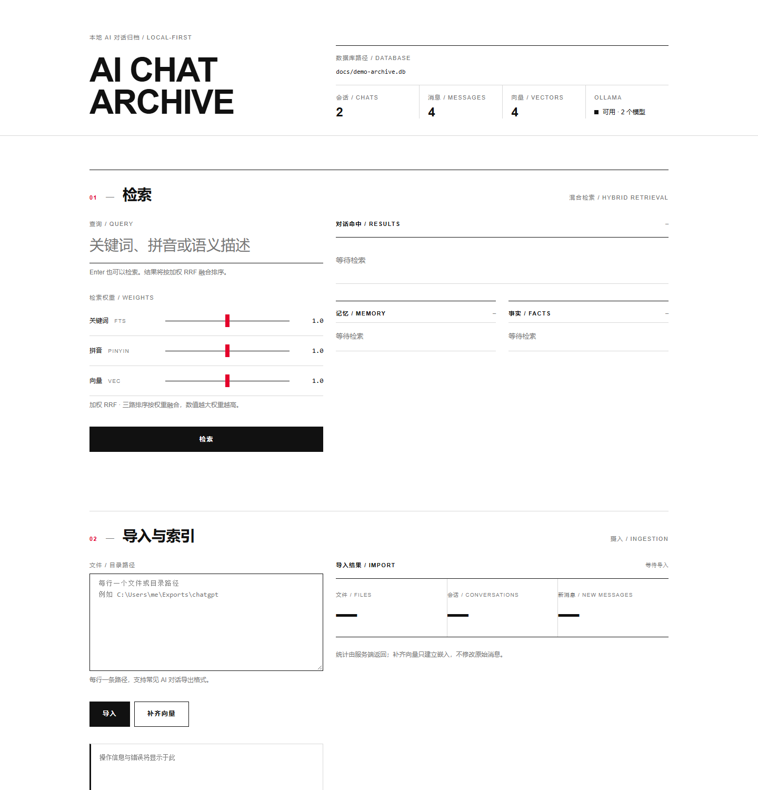
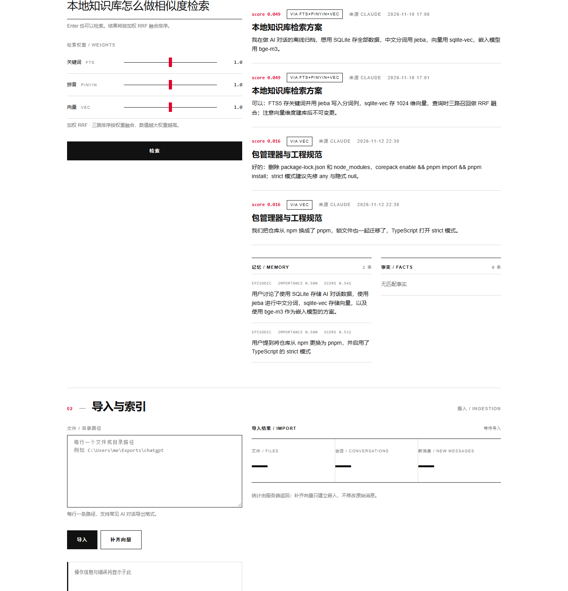

# ai-chat-archive

AI 对话本地归档：把 ChatGPT / Claude / Claude Code 的对话导出变成**可检索、可蒸馏、可跨设备同步**的私有知识库，并通过 **MCP server** 供任意 AI 客户端（Claude Desktop、Cursor、Cline、Trae 等）调用。

对应技术方案见《AI对话本地归档技术栈白皮书》（阶段一 MVP 实现，已接入真实 Ollama 本地模型验证）。

## 核心特性

- **单文件加密存储**：SQLite（better-sqlite3-multiple-ciphers，AES 加密，含 WAL）+ FTS5 全文 + sqlite-vec 向量，一个 `.db` 文件即全部数据
- **幂等导入**：ChatGPT 导出 ZIP / Claude 官方导出 JSON / Claude Code JSONL（自动过滤 sidechain）/ DeepSeek Harness 会话日志（`.jsonl.zstd`，多帧 zstd，只收真人输入与助手文本），重复导入零重复、增量导入只补新增消息
- **中文场景精化**：jieba 应用侧分词写入 FTS5；拼音列支持连写拼音检索（`fenci` → 分词）；检索结果 RRF 融合
- **混合检索**：关键词（FTS5）+ 拼音 + 语义向量（sqlite-vec KNN），三路 RRF 融合排序；向量路不可用时**显式告警降级**，不再静默吞错
- **真实 Ollama 接入**：对话模型（JSON 蒸馏）+ 嵌入模型（`bge-m3` 等）双通道，OpenAI 兼容端点与 Ollama 原生端点自动回退，带超时与指数退避重试
- **记忆蒸馏管线**：LLM 从对话抽取实体/事实/摘要（episodic 记忆），事实幂等入库，实体提及计数；蒸馏水位增量推进
- **自检命令**：`doctor` 一次性验证数据库、加密、向量维度、Ollama 端点、模型是否存在、真实 JSON 往返延迟
- **MCP server**：4 个正交工具（`recall` / `entity` / `remember` / `maintain`），stdio 传输，标准 MCP 协议
- **端到端加密同步**：`sync pack` 导出 AES-256-GCM 加密 blob（scrypt 派生密钥），任意哑存储可托管；`sync unpack` 幂等合并；blob 密码可与数据库密码不同

## 快速开始

```bash
npm install
npm run build

# 初始化（数据库默认 ~/.ai-chat-archive/archive.db；接入真实嵌入模型时自动探测维度）
node dist/cli.js init --password "你的密码"

# 导入（支持 .zip / .json / .jsonl / .jsonl.zstd / 目录）
node dist/cli.js import ~/Downloads/chatgpt-export.zip --password "你的密码"
node dist/cli.js import ~/.claude/projects --password "你的密码"
# DeepSeek Harness 会话日志（可直接给 .zstd，自动识别并解多帧）
node dist/cli.js import "~/.dsh/sessions/--<workspace>--/session-*/session.v4.jsonl.zstd" --password "你的密码"

# 检索（中文 / 拼音 / 英文均可）
node dist/cli.js search "向量检索" --password "你的密码"
node dist/cli.js search "fenci" --password "你的密码"

# 蒸馏（需要本地 Ollama 或任意 OpenAI 兼容端点）
ACA_LLM_MODEL=qwen2.5:3b node dist/cli.js distill --password "你的密码"

# 查询蒸馏结果
node dist/cli.js memory "包管理器偏好" --password "你的密码"
node dist/cli.js entities --password "你的密码"

# 跨设备同步（A 机打包 → 传到 B 机 → 合并）
node dist/cli.js sync pack archive.blob --password "你的密码"
node dist/cli.js sync unpack archive.blob --db ~/new-archive.db --password "你的密码"
# blob 可用独立密码：sync pack archive.blob --blob-password "另一个密码"
```

## 接入真实 Ollama（本地模型）

### 1. 启动 Ollama

已安装：直接 `ollama serve`。

免安装（Windows，本仓库实测方式）：官方提供 `ollama-windows-amd64.zip`，解压即用，无需管理员权限：

```bash
# 下载（GitHub 直连受限时，可在 URL 前加镜像前缀，如 https://gh-proxy.com/）
curl -L -o ollama-win.zip https://github.com/ollama/ollama/releases/latest/download/ollama-windows-amd64.zip
tar -xf ollama-win.zip

# 模型目录与监听地址（Windows PowerShell）
$env:OLLAMA_MODELS="D:\ollama-models"
$env:OLLAMA_HOST="127.0.0.1:11434"
$env:OLLAMA_CONTEXT_LENGTH="16384"   # 重要：默认约 2k，太小会让长对话被静默截断
.\ollama.exe serve
```

### 2. 拉取模型

```bash
ollama pull bge-m3        # 嵌入模型：1024 维，中文效果好（与默认 ACA_EMBED_DIM 一致）
ollama pull qwen2.5:3b    # 蒸馏用对话模型：JSON 输出稳定，约 1.9GB
```

> 显存/内存充足可换 `qwen2.5:7b`、`qwen3:4b`（注意 `qwen3` 有思考链，代码已兼容 `thinking` 字段）。
> 嵌入模型也可换 `quentinz/bge-large-zh-v1.5`（同为 1024 维）；`nomic-embed-text` 为 768 维，需同步改 `ACA_EMBED_DIM`。

### 3. 配置

```powershell
$env:ACA_PASSWORD="你的密码"
$env:ACA_LLM_MODEL="qwen2.5:3b"      # 不配置则蒸馏功能禁用
$env:ACA_EMBED_PROVIDER="ollama"     # hash（默认，伪向量）| ollama | openai-compatible
$env:ACA_EMBED_MODEL="bge-m3"
$env:ACA_EMBED_DIM="1024"
```

### 4. 自检

```bash
node dist/cli.js doctor --password "你的密码"
```

真实输出示例（Ollama 0.40 + RTX 5070 Laptop）：

```
Node.js v22.23.5 (win32/x64)
✅ 数据库 — .../archive.db（2 会话 / 4 消息 / 1024 维）
✅ 索引覆盖 — 向量 4 条，FTS 4 行
✅ LLM 端点 — http://127.0.0.1:11434/v1（5 个模型可用）
✅ LLM 模型 — qwen2.5:3b
✅ LLM 推理 — 1180ms 往返 → {"ok":true,"model":"self-test"}
✅ 嵌入端点 — http://127.0.0.1:11434/v1 / bge-m3 → 1024 维（86ms）
```

`doctor` 任一关键项失败会以非零退出码结束，适合放进部署脚本做前置检查。

### 5. 跑通全流程

```bash
node dist/cli.js init   --password "你的密码"
node dist/cli.js import ./my-export.json --password "你的密码"
node dist/cli.js index  --password "你的密码"   # 真实嵌入向量化
node dist/cli.js distill --password "你的密码"  # 真实 LLM 抽取事实/摘要
node dist/cli.js search "数据库加密怎么做" --password "你的密码"
node dist/cli.js memory "我喜欢用什么包管理器" --password "你的密码"
```

### 上下文长度（重要）

Ollama 的默认上下文通常只有 2k token 左右，**超出部分会被服务端静默截断**，症状是「接口一切正常，但长对话蒸馏出 0 条事实」。实测把上下文提到 16k 后，同一段对话才能抽出事实与摘要。

```powershell
$env:OLLAMA_CONTEXT_LENGTH="16384"   # qwen2.5:3b 支持 32k，16k 足够覆盖蒸馏转录
.\ollama.exe serve
```

配套限制：`distill` 默认每个会话只送 **8000 字**（`--max-chars` 可调），长对话按「头部 55% + 尾部 45%」保留，避免只留下开头而丢掉用户真正的提问。

### 维度约束（重要）

sqlite-vec 的 `vec0` 维度**建库时固定**：

- `init` 在 `ACA_EMBED_DIM` 未显式设置时会**探测真实模型维度**再建表；
- 维度写入 `sync_state.embed_dim`，换模型后打开旧库会得到明确报错，而不是 `sqlite-vec` 的底层插入错误；
- 更换嵌入模型需要重建库（FTS 不受影响，可 `import` 原始对话后重新 `index`/`distill`）。

## MCP 接入

Claude Desktop `claude_desktop_config.json` 示例：

```json
{
  "mcpServers": {
    "chat-archive": {
      "command": "node",
      "args": ["C:/path/to/ai-chat-archive/dist/cli.js", "mcp"],
      "env": {
        "ACA_PASSWORD": "你的密码",
        "ACA_LLM_MODEL": "qwen2.5:3b",
        "ACA_EMBED_PROVIDER": "ollama",
        "ACA_EMBED_MODEL": "bge-m3",
        "ACA_EMBED_DIM": "1024"
      }
    }
  }
}
```

### DeepSeek Harness（DSH）集成

本仓库已作为**纯配置 bundle**（`@local/aca-chat-archive-mcp`）接入 DeepSeek Harness，4 个工具以 `mcp__chat-archive__<tool>` 形式出现在会话中（安装返回 `application: applied`，即时生效）。

bundle 位于工作区 `aca-dsh-mcp-bundle/`，安装方式是 `link:`，**不要删除或移动该目录**（移动后需重装）：

```
aca-dsh-mcp-bundle/
├─ package.json        # dsh.bundle.patch → cordis.patch.yml
├─ cordis.patch.yml    # insert: @deepseek-ai/dsh-mcp-client（stdio + env）
├─ locale/en.json      # 插件列表标题/描述（英文）
├─ locale/zh.json      # 插件列表标题/描述（中文）
└─ icon.svg            # 36×36 原创图标
```

安装方式：在 DSH 会话中调用 `plugin_manager` 工具，`action: install_bundle`、`target: <工作区绝对路径>/aca-dsh-mcp-bundle`（无需手改 profile 的 `cordis.patch.yml`）。

前置条件：

1. 本仓库已构建：`npm run build`（bundle 启动 `dist/cli.js mcp`）
2. **Node 版本需匹配原生模块 ABI**：bundle 中使用 Node 22 绝对路径（默认 `C:\nodejs\node-v22.23.5-win-x64\node.exe`，按你的实际安装位置调整）
3. 归档库已初始化：`node dist/cli.js init --password "..."`
4. 语义检索与蒸馏需要 Ollama 在运行（`bge-m3` + `qwen2.5:3b`）；未运行时检索自动降级为关键词 + 拼音并返回告警

修改配置：编辑 `aca-dsh-mcp-bundle/cordis.patch.yml` 的 `env` / `command` / `args`，保存后**重启 DSH** 生效（或在插件管理里禁用再启用）。

卸载：DSH 设置 → 插件，或在会话中 `plugin_manager` `action: remove_bundle`、`target: "@local/aca-chat-archive-mcp"`；卸载只移除工具，不影响归档文件。

> `cordis.patch.yml` 中的 `ACA_PASSWORD` 为**明文**：它只保护本地归档文件，请勿把该 bundle 目录分享给他人；如需更安全的密钥管理，应改用凭据存储并把密码移出配置。

### 工具面

| 工具 | 用途 |
|---|---|
| `recall(query, source?, since?, until?, limit?, includeMemory?, weights?)` | 一次取回对话片段 + 蒸馏记忆与事实（关键词+拼音+向量加权 RRF） |
| `entity(name?, type?, limit?)` | 指定 `name` → 实体上下文（事实+来源对话）；省略 → 实体列表 |
| `remember(content, layer?, tags?, importance?)` | 手动写入记忆并立即向量化 |
| `maintain(action: status\|distill, limit?)` | `status` 统计；`distill` 增量蒸馏 |

> 早期版本的 7 个工具（search_conversations / query_memory / get_context / list_entities / add_memory / distill / archive_status）已合并为上述 4 个：schema 体积降约 43%，且一次 `recall` 就能拿到“原文 + 记忆 + 事实”，减少多轮工具往返。

## 可视化界面（UI）

终端命令全部保留，但日常操作可以完全在浏览器里完成：零前端依赖、单页应用，视觉遵循**瑞士国际主义风格**（白底黑字、唯一强调色 `#E4002B`、12 列栅格、8px 间距基准、无圆角无阴影）。

```bash
npm run build
node dist/cli.js ui --port 7788     # 或 npm run ui
# → 可视化界面: http://127.0.0.1:7788
```



五个编号区块对应五类操作：

| 区块 | 能做什么 |
|---|---|
| **01 检索** | 关键词 / 拼音 / 语义三路**加权 RRF**（0–2 滑杆，实时生效）；结果带 score 与命中路径徽标，同屏显示记忆与事实 |
| **02 导入与索引** | 粘贴文件或目录路径批量导入（支持 zip / json / jsonl / jsonl.zstd / 目录）；一键补齐缺失向量 |
| **03 蒸馏** | 本地 Ollama 或**云端 API**（baseUrl + model + API Key）；limit / maxChars 可调 |
| **04 模型（Qwen）** | Qwen 预设一键安装（`qwen2.5:1.5b` / `3b` / `7b`、`qwen3:4b`）或任意模型名；安装进度 NDJSON 实时回显 |
| **05 设置** | 权重与提供商保存到 `~/.ai-chat-archive/config.json`（环境变量优先），并显示当前生效配置 |



**权重怎么生效**：三路召回各自按 `weight / (60 + rank)` 累加（加权 RRF）。把某一路调到 0 就等于关掉该路；UI、CLI 与 MCP 的 `recall` 共用同一份权重（显式传参 > 已保存设置 > 1:1:1）。

**云端蒸馏**：任何 OpenAI 兼容端点（DeepSeek、Moonshot、OpenAI…）均可；API Key 只在这次请求里从浏览器传给本机服务端，不落盘、不写日志。需要长期复用时，在「05 设置」里显式保存（写入本地 `config.json`）。

**本地 HTTP 接口**（只监听 `127.0.0.1`，无鉴权，请勿暴露到公网）：

| 方法 | 路径 | 说明 |
|---|---|---|
| GET | `/api/state` | 统计 / 生效权重 / Ollama 状态 / 模型预设 |
| POST | `/api/search` | `{query, limit?, source?, weights?, includeMemory?}` |
| POST | `/api/import` / `/api/index` | 导入路径 / 补齐向量 |
| POST | `/api/distill` | `{provider: "ollama"\|"cloud", baseUrl?, model?, apiKey?, limit?, maxChars?}` |
| GET / PUT | `/api/config` | 读取 / 保存权重与提供商（Key 回显为 `hasKey`） |
| GET / POST | `/api/models` / `/api/models/pull` | 已装模型列表 / NDJSON 流式安装 |
| GET | `/api/entity` | 实体列表（`?list=1`）或上下文（`?name=`） |
| POST | `/api/remember` | 手动写入记忆并向量化 |

## 命令概览

| 命令 | 说明 |
|---|---|
| `init` | 初始化加密库（真实嵌入模型下自动探测维度） |
| `import <paths...>` | 导入 zip / json / jsonl / jsonl.zstd（DSH 会话）/ 目录 |
| `index` | 为未向量化消息补齐语义向量 |
| `distill [--limit --max-chars --force]` | 记忆蒸馏（LLM 抽取事实/摘要）；`--force` 忽略蒸馏水位强制重蒸 |
| `search <query> [--source --since --until --limit]` | 混合检索 |
| `memory <query> [--layer --limit]` | 查询记忆与事实 |
| `context <name>` / `entities` | 实体上下文 / 实体列表 |
| `status` | 归档统计 |
| `doctor` | 全链路自检（数据库/加密/维度/端点/模型/JSON 往返） |
| `mcp` | stdio 启动 MCP server |
| `ui [--port]` | 启动本地可视化界面（瑞士风格，替代终端操作） |
| `sync pack <out>` / `sync unpack <blob>` | 加密打包 / 幂等合并（支持 `--blob-password`） |

## 配置

| 环境变量 | 默认 | 说明 |
|---|---|---|
| `ACA_DB` | `~/.ai-chat-archive/archive.db` | 数据库路径 |
| `ACA_HOME` | `~/.ai-chat-archive` | 设置文件（`config.json`）与默认数据库所在目录 |
| `ACA_UI_PORT` | `7788` | `ui` 命令默认端口 |
| `ACA_OLLAMA_BASE` | 由 `ACA_EMBED_BASE_URL` 推导 | UI 探测/安装模型用的 Ollama 原生地址 |
| `ACA_PASSWORD` | — | 数据库密码（CLI 也可 `--password`） |
| `ACA_LLM_BASE_URL` | `http://127.0.0.1:11434/v1` | 蒸馏 LLM（OpenAI 兼容，默认 Ollama） |
| `ACA_LLM_MODEL` | 未配置则蒸馏禁用 | 如 `qwen2.5:3b` |
| `ACA_LLM_API_KEY` | — | 远端 API key |
| `ACA_LLM_TIMEOUT_MS` | `180000` | 单次推理超时（本地 CPU 推理建议调大） |
| `ACA_LLM_RETRIES` | `2` | 网络/5xx 重试次数 |
| `ACA_LLM_JSON_MODE` | `1` | 是否请求 `response_format=json_object`；端点不支持会自动回退 |
| `ACA_LLM_TEMPERATURE` | `0` | 采样温度（抽取任务建议 0） |
| `ACA_LLM_MAX_TOKENS` | — | 最大输出 token（不设置交给服务端） |
| `ACA_EMBED_PROVIDER` | `hash` | `hash`（零依赖降级，词袋伪向量）/ `ollama` / `openai-compatible` |
| `ACA_EMBED_BASE_URL` | 同 `ACA_LLM_BASE_URL` | 嵌入端点 |
| `ACA_EMBED_MODEL` | `bge-m3` | 嵌入模型（需与建库维度一致） |
| `ACA_EMBED_DIM` | `1024` | 向量维度（建库时固定；留空则由 `init` 探测） |
| `ACA_EMBED_BATCH` | `16` | 单批嵌入文本数 |
| `ACA_EMBED_CHUNK` | `256` | 向量化分块大小（避免大库一次性占满内存） |
| `ACA_EMBED_KEEP_ALIVE` | `30m` | Ollama 模型驻留时长，避免卸载后冷启动（实测冷启动可达十几秒） |
| `ACA_EMBED_TIMEOUT_MS` / `ACA_EMBED_RETRIES` | `60000` / `2` | 嵌入请求超时与重试 |
| `ACA_CACHE` | `1` | 检索缓存总开关（`0` 关闭，用于基准测试冷路径） |
| `ACA_CACHE_VEC_ENTRIES` / `ACA_CACHE_VEC_TTL_MS` | `256` / `600000` | 查询向量缓存条数 / TTL |
| `ACA_CACHE_RESULT_ENTRIES` / `ACA_CACHE_RESULT_TTL_MS` | `128` / `120000` | 检索结果缓存条数 / TTL（写入类操作会主动失效） |
| `ACA_PINYIN_CACHE` | `20000` | 拼音按词缓存上限 |

> `hash` 嵌入仅供无模型环境跑通流程；语义检索请配置真实嵌入模型。

## 架构

```
导出文件 (.zip/.json/.jsonl)
   │  importers (格式识别 + 幂等 upsert)
   ▼
SQLite 单文件（SQLCipher 兼容加密）
   ├─ conversations / messages（原始层，不可变）
   ├─ messages_fts（jieba 分词列 + 拼音列）
   ├─ message_vec / memory_vec（sqlite-vec，维度写入 sync_state）
   ├─ entities / facts / memories（蒸馏层，可重建）
   ▼
Ollama（bge-m3 嵌入 + qwen2.5 蒸馏，可换任意 OpenAI 兼容端点）
   ▼
MCP server（stdio）──4 个工具──▶ Claude Desktop / Cursor / Cline / Trae…
   ▼
sync pack/unpack（AES-256-GCM blob，哑存储零知识）
```

原始层与蒸馏层分离：蒸馏产物（实体/事实/记忆/向量）全部可由原始对话重建，换模型重蒸馏即可升级。

## 性能

本机实测（`npm run bench`：2000 条中文消息 / 1024 维 / RTX 5070 Laptop；用 hash 嵌入隔离网络影响）：

| 指标 | 优化前 | 优化后 | 变化 |
|---|---|---|---|
| 分词（导入路径，每条） | 0.057 ms | **0.010 ms** | 5.7× |
| 导入（中文，每条） | 0.206 ms | **0.142 ms** | -31% |
| 混合检索（冷路径，每次） | 4.06 ms | 3.9–4.3 ms | 持平（KNN 固定成本） |
| 混合检索（重复查询） | 4.06 ms | **0.001 ms** | 缓存命中 |
| 记忆查询（每次） | 1.81 ms | **1.60 ms** | -12% |

改动要点：

1. **分词合并**：原来 content 与 pinyin 各切一次 jieba；改为一次切词同时产出两列，并对 CJK 词做**拼音按词缓存**（对话词表高度重复）。
2. **语句缓存**：热路径 SQL 复用 prepared statement，避免每次 `prepare`。
3. **查询向量 + 结果缓存**：真实 Ollama 下一次查询嵌入是 10–50ms 的网络往返；缓存后重复查询接近零成本。写入类操作（导入/蒸馏/手动记忆）会主动失效，且缓存按 Db 实例分区，避免同进程多库串味。
4. **分块向量化**：默认 256 条/块、每块独立事务，内存占用可预期。
5. **`keep_alive`**：嵌入请求带 `keep_alive=30m`，避免 Ollama 卸载模型后冷启动（实测十几秒）。
6. **SQLite 调优**：`synchronous=NORMAL`（WAL 下安全）、`temp_store=MEMORY`、32MB 页缓存、256MB mmap。

### 为什么没有用 Rust 重写

实测的瓶颈分布说明重写不划算：

- 检索的 ~3ms 几乎全部花在 sqlite-vec 的**向量全表扫描**上，它本身就是 C 实现（含 SIMD），换语言不会更快；
- 分词 0.01ms 已经在 **Rust 写的 `@node-rs/jieba`** 里；
- 真正的大头是**模型推理与网络**（3b 模型蒸馏一次、嵌入一次往返），Node 侧的 JS 开销可以忽略；
- 导入的 0.14ms/条与向量写入的 0.22ms/条几乎都是 SQLite / sqlite-vec 的写放大。

因此本轮走「缓存 + 批处理 + 原生扩展」路线，而不是重写一个 Rust 服务。

> 数据量再上一个量级（10 万条以上）时，KNN 全表扫描会成为主导，届时应该引入 ANN 索引（hnswlib / sqlite-vec 后续的 ANN 支持）或 int8 量化，而不是换语言。

## 测试

```bash
npm run build
npm run test:all      # e2e 24 + dsh 15 + UI 22 + MCP 11 + CLI 10 + 真实 Ollama 27（合计 109）
```

| 套件 | 项数 | 依赖 |
|---|---|---|
| `npm test`（e2e） | 24 | 无（mock LLM 服务） |
| `npm run test:dsh` | 15 | 无（DSH 会话解析 + 多帧 zstd） |
| `npm run test:ui` | 22 | 无（内置假 Ollama，含加权检索/配置落盘/流式安装） |
| `npm run test:mcp` | 11 | 无 |
| `npm run test:cli` | 10 | 需先 `npm run build` |
| `npm run test:ollama` | 27 | 需运行中的 Ollama + `qwen2.5:3b` + `bge-m3` |

真实 Ollama 套件覆盖：端点/模型探测、嵌入维度校验（不匹配抛 `EmbedDimError`）、维度元数据与旧库拒绝、真实向量语义检索（查询与原文无字面重合）、真实 LLM JSON 往返、端到端蒸馏（事实/记忆/实体入库）、记忆语义召回、重复蒸馏幂等。

服务或模型缺失时该套件默认打印 `SKIP` 并以 0 退出；CI 里设置 `ACA_TEST_REQUIRE=1` 可改为失败。

### Node 版本

原生模块（`better-sqlite3-multiple-ciphers`、`sqlite-vec`）按 Node ABI 编译：仓库内 `node_modules` 为 **Node 22（ABI 127）** 预编译产物，Node 20/24 会报 `NODE_MODULE_VERSION` 不匹配。换 Node 大版本后执行 `npm rebuild`（若 GitHub 不可达，prebuild 下载会失败，需本地编译或改用对应 ABI 的 Node）。

## 已知限制

- `sqlite-vec` v0.1.9 的整数主键插入存在兼容性问题，本项目使用 TEXT 主键规避
- 同步为全量快照 blob（阶段二引入 cr-sqlite 做细粒度 CRDT 合并）
- 事实抽取为 ADD-only，未做矛盾检测与失效标记（`valid_to` 字段已预留）
- 嵌入模型一经建库不可更换维度；更换模型需重建库（FTS 不受影响）
- 蒸馏为串行处理（本地模型并发收益有限），大批量导入建议分批 `--limit`

## License

Apache-2.0
